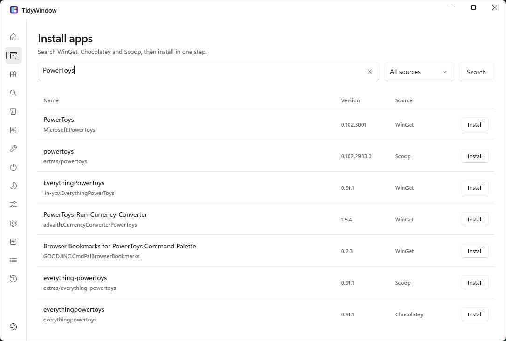
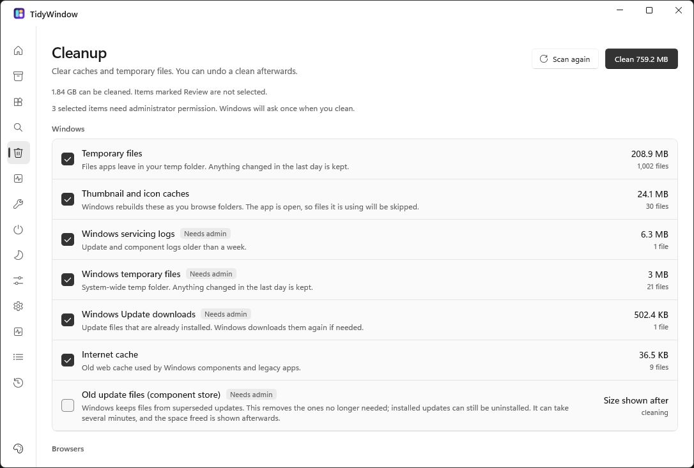
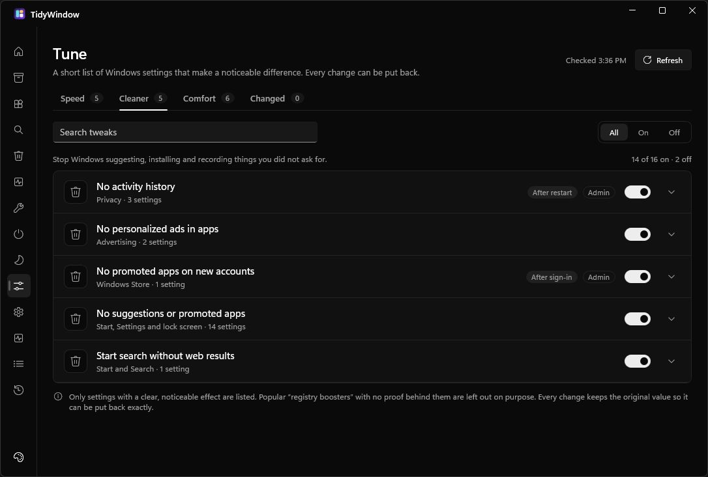

<div align="center">


# TidyWindow

**Install your apps. Find your files. Keep Windows tidy.**

A native Windows app that brings package managers, cleanup and everyday repairs into one place.<br />
See what will change before it runs, with saved originals for the changes you can undo.

[](https://github.com/Cosmos-0118/TidyWindow/actions/workflows/ci.yml)
[](https://github.com/Cosmos-0118/TidyWindow/releases/latest)


[](LICENSE)

**[Download TidyWindow](https://github.com/Cosmos-0118/TidyWindow/releases/latest)** ·
[Explore the app](#explore-the-app) ·
[Build from source](#build-from-source) ·
[Report a bug](https://github.com/Cosmos-0118/TidyWindow/issues)

</div>

> [!NOTE]
> **This is TidyWindow 5, rebuilt from the ground up with WinUI 3.** The previous v4.x app lives on the [`legacy`](https://github.com/Cosmos-0118/TidyWindow/tree/legacy) branch and is no longer developed. The two versions share no code.

## One place for the everyday work

Finding an app, fixing a broken install and clearing old caches usually means switching between package managers, Settings and a terminal. TidyWindow brings those jobs together, with plain descriptions of what each action does.

- **Three package managers, one search.** Find software across WinGet, Chocolatey and Scoop, review the install, then follow its progress in a shared queue.
- **Changes you can inspect.** Windows settings come from small, reviewed catalogs. You can see the change, its permissions and any restart requirement before running it.
- **A way back where it matters.** Startup, Quiet and Tune save original states. Cleanup holds selected file categories for undo, and repairs explain their commands and limits before they run.
- **Made for Windows.** Native WinUI 3 controls, light and dark themes, and desktop integration, built with C# and .NET 10.

<p align="center">
  <a href="docs/images/install-hub-light.png"></a>
  <br />
  <sub><b>One search across your package sources.</b> Results keep their package ID, version and source visible.</sub>
</p>

## Get started

**Windows 10 (build 19041 / version 2004) or later · x64**

The downloads include .NET and the Windows App SDK. You do not need to install either separately.

| Download | How to use it |
| --- | --- |
| **Installer** — `TidyWindow-Setup-<version>.exe` | Download from [the latest release](https://github.com/Cosmos-0118/TidyWindow/releases/latest) and run it. Installs for your account by default, with an option to install for all users. Adds a Start menu entry. |
| **Portable** — `TidyWindow-<version>-win-x64.zip` | Extract the whole archive into a folder, then run `TidyWindow.Next.exe`. Keep the helper folders alongside it. |

1. Open **Overview** to check which package managers are available. It offers setup help for missing managers; you only need one to start searching for apps.
2. Open **Install Hub**, search for an app, and review the package and source before installing. **Queue** shows progress and command output.
3. Explore **Cleanup**, **Startup** or the other tools below when you need them. Each page explains the actions it offers.

Scout can search a chosen folder on its own. Searching Home or This PC uses [Everything](https://www.voidtools.com/)'s local index; Scout offers setup when it is missing.

## Explore the app

| Tool | What you can do |
| --- | --- |
| **Overview** | Check the status and versions of WinGet, Chocolatey and Scoop, with setup help when needed. |
| **Install Hub** | Search all available package sources together, see what is already installed, and review an install before it starts. |
| **Installed** | Browse installed packages, check available versions, update, uninstall or hold packages. |
| **Scout** | Find files and folders by name or path, filter by type or location, copy a path or open its folder. |
| **Cleanup** | Scan caches and temporary files, choose what to clean, and hold old installers and unfinished downloads for 14 days so they can be restored. |
| **Path Doctor** | See which program runs for a command and fix the PATH folders and their order. |
| **Repair** | Recover installs and uninstalls blocked by an earlier cancelled or crashed installer, with backups of removed data. |
| **Startup** | Choose what opens with Windows and restore an entry to its original state. |
| **Quiet** | Turn reviewed Windows background items off and back on, including telemetry, Recall and optional services. |
| **Tune** | Apply a focused set of registry settings, inspect current values and restore saved originals. |
| **Fixes** | Run standard Windows repairs for system files, Windows Update, networking, audio and more. Inspect the commands first and follow their live output. |
| **Lab** | Compare a 15-second performance check with the previous one, switch power plans or temporarily change one app's priority. |
| **Queue** | Follow installs, updates and uninstalls from every page, one operation at a time. |
| **Logs** | Review outcomes and problems that need attention, without a stream of routine activity. |

<table>
  <tr>
    <td width="50%" align="center">
      <a href="docs/images/cleanup-light.png"></a><br />
      <sub><b>Choose what goes.</b> Cleanup shows the categories and their sizes before you clean.</sub>
    </td>
    <td width="50%" align="center">
      <a href="docs/images/tune-dark.png"></a><br />
      <sub><b>Know what changes.</b> Tune explains each setting and shows its current state.</sub>
    </td>
  </tr>
</table>

<p align="center"><sub>Real app captures in light and dark themes. Click an image for the full-size view. Available items, package versions and results depend on your PC.</sub></p>

## Before a change runs

TidyWindow keeps the action and its consequences visible:

- **Reviewed actions.** Cleanup, Quiet, Tune, Fixes and Lab use catalogs validated at startup, with a second allowlist that rejects actions outside them.
- **Permissions when needed.** The app runs without administrator rights. Windows-wide changes use a separate helper, `TidyWindow.CleanHost.exe`, after you approve the Windows prompt.
- **Saved originals.** Reversible changes save their original state before writing. Held cleanup files, installer repair backups and startup restore data survive app restarts.
- **Checked results.** Changes are read back where supported. An unverified outcome is reported as unverified rather than claimed as a success.

Undo is specific to the tool. Cleanup holds old installers and unfinished downloads for 14 days; ordinary caches are deleted, and emptying the Recycle Bin cannot be undone. Package installs and Windows repair commands do not have a universal rollback. Fixes shows the commands it will run before you proceed.

<details>
<summary><b>How the package queue behaves</b></summary>

Installs, updates and uninstalls share one queue. It runs one operation at a time, rejects duplicate or conflicting requests for the same manager, package and scope, and continues after a failure. The app checks the package inventory after the command exits.

Installer dialogs and Windows administrator prompts remain native windows. Chocolatey and global Scoop operations use a separate elevated window, so their output is shown there instead of inside TidyWindow. Declining elevation reports a failure and the queue moves on.

The queue belongs to the current session and does not resume after a crash. Closing the app is blocked while work remains.

</details>

## Build from source

You need **Windows 10 build 19041 or later (x64)** and the **[.NET 10 SDK](https://dotnet.microsoft.com/download/dotnet/10.0)**. The SDK version and roll-forward policy are in [`global.json`](global.json). Package managers are optional for building.

```powershell
git clone https://github.com/Cosmos-0118/TidyWindow.git
cd TidyWindow

dotnet restore TidyWindow.slnx --locked-mode
dotnet build src/TidyWindow.Desktop/TidyWindow.Desktop.csproj -c Release --no-restore --output artifacts/preview
./artifacts/preview/TidyWindow.Next.exe
```

Run the tests:

```powershell
dotnet test tests/TidyWindow.Tests/TidyWindow.Tests.csproj -c Release --no-restore
```

The standard tests do not install packages or change Windows settings. To opt into live, read-only machine checks, set `$env:TIDYWINDOW_LIVE_TESTS = '1'` before running them.

<details>
<summary><b>Build a self-contained folder or installer</b></summary>

To bundle .NET and the Windows App SDK:

```powershell
dotnet build src/TidyWindow.Desktop/TidyWindow.Desktop.csproj -c Release --self-contained true -o artifacts/publish
```

Use **`dotnet build`** for this app. `dotnet publish` leaves out the compiled pages (`*.xbf`) and `TidyWindow.Next.pri`, causing the app to close at startup.

To build an installer, install [Inno Setup 6](https://jrsoftware.org/isinfo.php), build the self-contained folder above, then run:

```powershell
pwsh installer/build.ps1 -Version 5.0.0 -PublishDir artifacts/publish
```

The installer asks before removing settings and undo data during uninstall. The release workflow tests the app, builds both the installer and portable ZIP, and checks installation and uninstallation before attaching the files to a GitHub release.

`main` is the current app; CI builds and tests pushes and pull requests. Pushing a version tag such as `v5.0.0` runs the release workflow. An existing release keeps its title and notes when build assets are attached. Releases through v4.7.x belong to the legacy app.

</details>

## Documentation

The research notes explain what each tool changes, the evidence behind it, and what was deliberately left out.

| Guide | What is inside |
| --- | --- |
| [Architecture and behavior](docs/architecture.md) | Project map, package search, queue behavior, Scout and logging. |
| [Scout](docs/scout-research.md) | Local filename search, Everything integration and search limits. |
| [Installer repair](docs/repair-research.md) · [Validation](docs/repair-validation.md) | Recovery strategy, backups and the checks behind Repair. |
| [Quiet](docs/quiet-research.md) | Background services, tasks and policies, with exclusions and dependency checks. |
| [Tune](docs/tune-research.md) | Registry settings, their effects and the tweaks left out for lack of evidence. |
| [Fixes](docs/fixes-research.md) | Standard Windows repair commands, scope and limitations. |
| [Lab](docs/lab-research.md) | What the performance check measures and how comparisons work. |

## Contributing

Bug reports, ideas and pull requests are welcome. [Open an issue](https://github.com/Cosmos-0118/TidyWindow/issues) with the page you were using, your Windows version, and what you expected to happen. Review logs before sharing them, since package names and local paths can still appear.

For code changes, run the tests above and keep catalog entries tied to documented Windows behavior. Research notes are part of the project: explaining why a change should exist matters as much as implementing it.

## License

TidyWindow is released under the **[MIT license](LICENSE)**. The bundled Everything SDK has its own [license](src/TidyWindow.SearchHost/Assets/LICENSE-Everything-SDK.txt) and [notice](src/TidyWindow.SearchHost/Assets/NOTICE.md).
