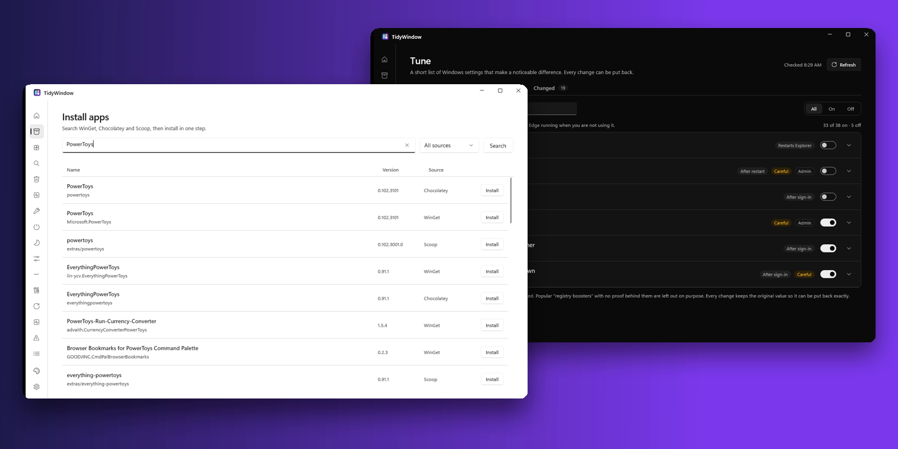
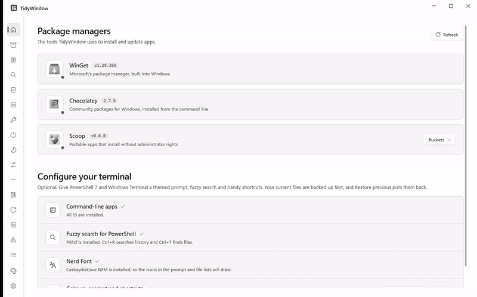
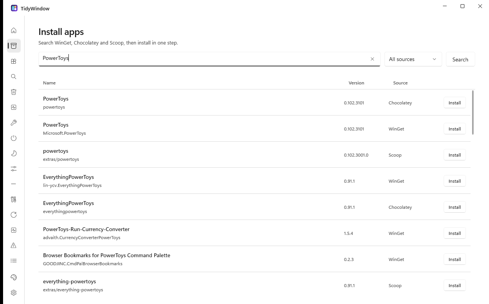
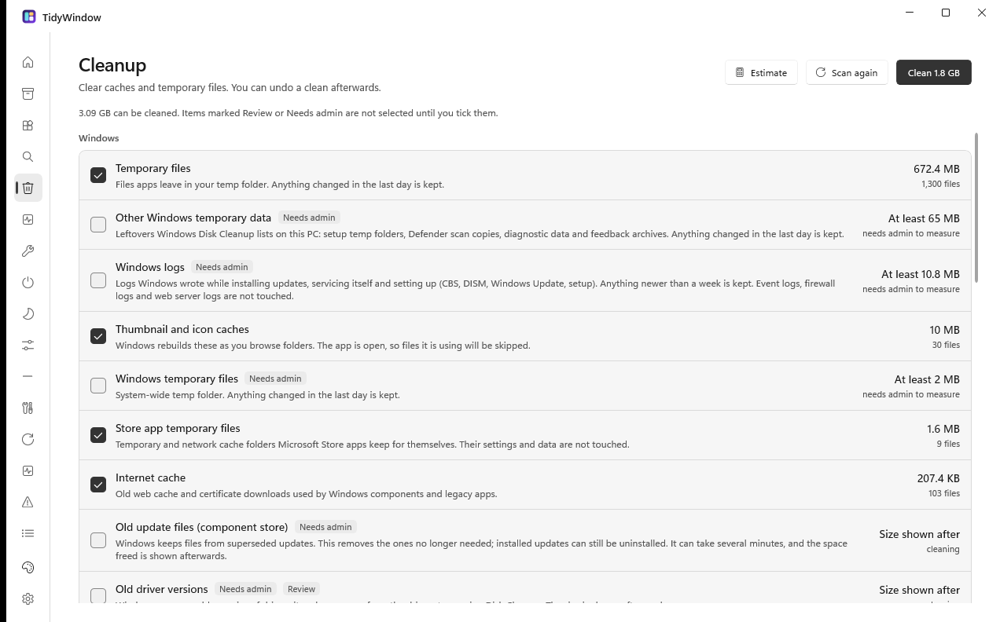
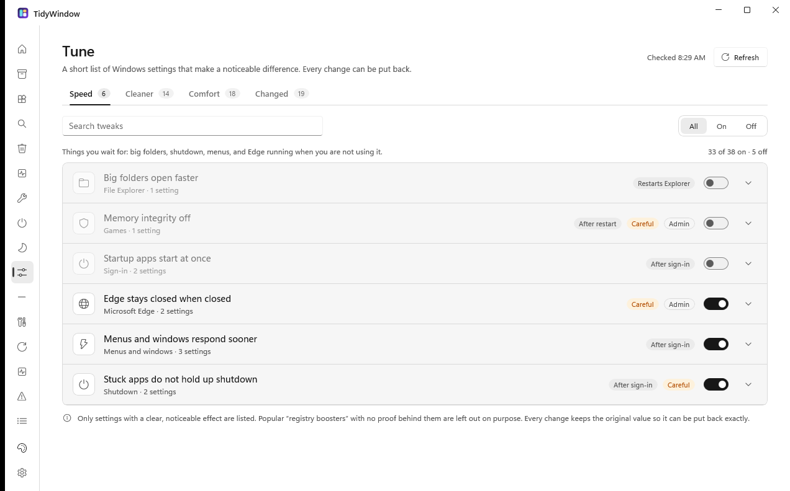
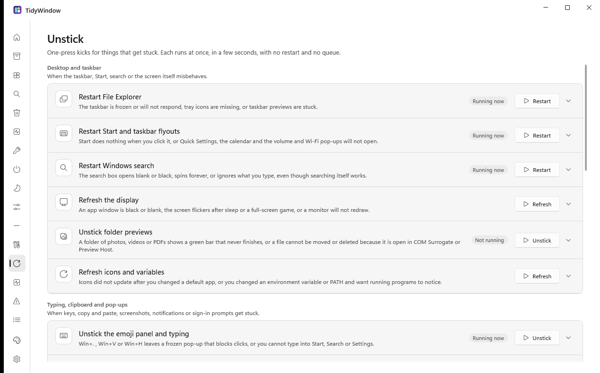
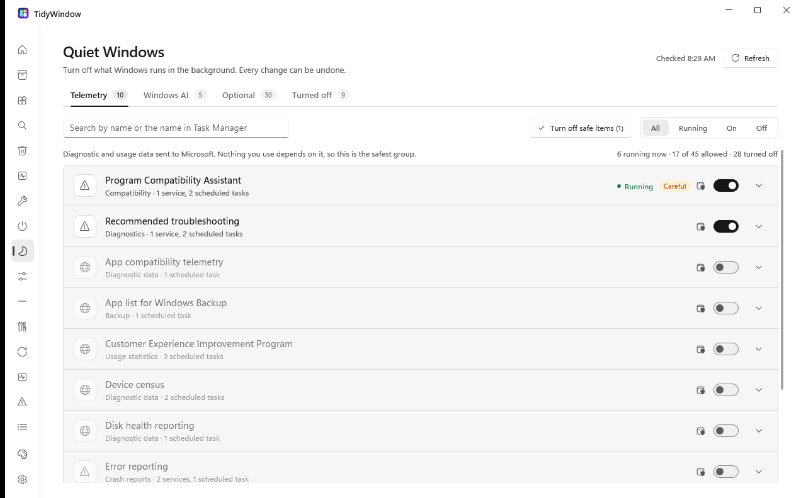
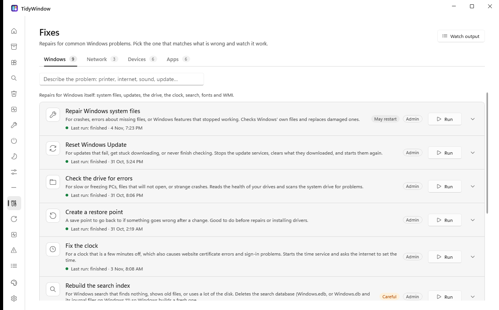
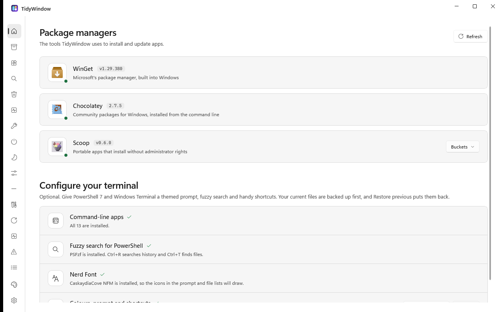

<div align="center">


# TidyWindow

### Install your apps. Find your files. Keep Windows tidy.

A native Windows app that puts package managers, cleanup and everyday repairs in one place.<br />
See what will change **before** it runs, with saved originals for the changes you can undo.

[](https://github.com/Cosmos-0118/TidyWindow/actions/workflows/ci.yml)
[](https://github.com/Cosmos-0118/TidyWindow/releases/latest)
[](https://github.com/Cosmos-0118/TidyWindow/releases)
[](https://github.com/Cosmos-0118/TidyWindow/stargazers)
[](LICENSE)


<br />

**[⬇️ Download](https://github.com/Cosmos-0118/TidyWindow/releases/latest)** &nbsp;·&nbsp;
**[✨ Features](#features)** &nbsp;·&nbsp;
**[🛡️ Safety](#built-to-be-trusted)** &nbsp;·&nbsp;
**[🛠️ Build](#build-from-source)** &nbsp;·&nbsp;
**[🐞 Report a bug](https://github.com/Cosmos-0118/TidyWindow/issues)**

<br />



</div>

> [!NOTE]
> **This is TidyWindow 5, rebuilt from the ground up with WinUI 3.** The previous v4.x app lives on the [`legacy`](https://github.com/Cosmos-0118/TidyWindow/tree/legacy) branch and is no longer developed. The two versions share no code.

## Why TidyWindow?

Finding an app, fixing a broken install and clearing old caches usually means bouncing between package managers, Settings and a terminal. TidyWindow brings those jobs together and explains what each action does in plain words.

|  |  |
| :-- | :-- |
| 📦 **Three package managers, one search** | Search WinGet, Chocolatey and Scoop together, review the install, then follow it in a shared queue. |
| 🔍 **Changes you can inspect** | Windows settings come from small, reviewed catalogs. See the change, its permissions and any restart requirement before you run it. |
| ↩️ **A way back where it matters** | Startup, Quiet and Tune save original states. Debloat keeps a list of what it removed so you can put it back. Cleanup holds selected files for undo. |
| 🪟 **Made for Windows** | Native WinUI 3 controls, light and dark themes and desktop integration, built with C# and .NET 10. |

<div align="center">



<sub>A quick tour in light and dark themes. Available items, package versions and results depend on your PC.</sub>

</div>

## Get started

**Windows 10 (build 19041 / version 2004) or later · x64.** The downloads include .NET and the Windows App SDK, so there is nothing else to install.

| | Download | How to use it |
| :-- | :-- | :-- |
| 💿 | **Installer**<br /><sub>`TidyWindow-Setup-<version>.exe`</sub> | Run it from [the latest release](https://github.com/Cosmos-0118/TidyWindow/releases/latest). Installs for all users by default, asks for administrator permission once during setup, and adds a Start menu entry. The first page offers a per-user install instead. |
| 🗜️ | **Portable**<br /><sub>`TidyWindow-<version>-win-x64.zip`</sub> | Extract the whole archive into a folder and run `TidyWindow.Next.exe`. Keep the helper folders alongside it. |

> [!IMPORTANT]
> **Where the app lives matters.** Windows-wide changes run through a helper program that starts from the install folder each time you approve an administrator prompt. In the default location, Program Files, only administrators can change that folder. A per-user install or the portable ZIP puts the app in a folder your account can write to, so any program running as you could swap the helper before your next approved prompt, and the prompt would then approve that program. If you choose one of those, put the folder somewhere only administrators can change, or accept that trade-off.

Each release also carries `SHA256SUMS.txt` and a build attestation that records which workflow run produced the files. [Build from source](#build-from-source) shows how to check a download.

**Your first five minutes**

1. Open **Overview** to see which package managers are available. It offers setup help for missing ones, and you only need one to start.
2. Open **Install Hub**, search for an app and review the package and source before installing. **Queue** shows progress and command output.
3. Explore **Cleanup**, **Startup** and the other tools when you need them. Each page explains the actions it offers.

## Features

### 📦 Install and update

<table>
  <tr>
    <td width="50%" valign="top">
      <picture>
        <source media="(prefers-color-scheme: dark)" srcset="docs/images/install-hub-dark.png" />
        
      </picture>
    </td>
    <td width="50%" valign="top">
      <h4>One search across your package sources</h4>
      <p>Results keep their package ID, version and source visible, so you always know what you are installing and from where.</p>
      <ul>
        <li><b>Install Hub</b>: search every source together and review an install before it starts.</li>
        <li><b>Installed</b>: browse packages, check versions, update, uninstall or hold.</li>
        <li><b>Queue</b>: installs, updates and uninstalls from every page, one at a time.</li>
        <li><b>Overview</b>: status and versions of WinGet, Chocolatey and Scoop, plus optional <b>Configure your terminal</b> (themed PowerShell 7 and Windows Terminal, backed up first and undoable).</li>
      </ul>
    </td>
  </tr>
</table>

### 🧹 Clean up

<table>
  <tr>
    <td width="50%" valign="top">
      <h4>Choose what goes</h4>
      <p>Cleanup shows each category and its size before you clean. Old installers and unfinished downloads are held for 14 days so you can restore them.</p>
      <ul>
        <li><b>Cleanup</b>: scan caches and temporary files and pick what to clear.</li>
        <li><b>Scout</b>: find files and folders by name or path, with filters like <code>kind:pdf size:&gt;10mb date:7d</code>.</li>
        <li><b>Path Doctor</b>: see which program runs for a command and fix your PATH folders and their order.</li>
      </ul>
    </td>
    <td width="50%" valign="top">
      <picture>
        <source media="(prefers-color-scheme: dark)" srcset="docs/images/cleanup-dark.png" />
        
      </picture>
    </td>
  </tr>
</table>

### 🎛️ Tune and quiet Windows

<table>
  <tr>
    <td width="50%" valign="top">
      <picture>
        <source media="(prefers-color-scheme: dark)" srcset="docs/images/tune-dark.png" />
        
      </picture>
    </td>
    <td width="50%" valign="top">
      <h4>Know what changes</h4>
      <p>Every setting explains itself and shows its current state. Popular "registry boosters" with no proof behind them are left out on purpose.</p>
      <ul>
        <li><b>Tune</b>: a focused set of registry settings; inspect values and restore saved originals.</li>
        <li><b>Quiet</b>: turn reviewed background items off and back on, including telemetry, Recall and optional services.</li>
        <li><b>Startup</b>: choose what opens with Windows and restore an entry to its original state.</li>
        <li><b>Debloat</b>: remove default, promoted and manufacturer apps, Recall, OneDrive and Edge for every account, then put them back from the Removed tab.</li>
      </ul>
    </td>
  </tr>
</table>

### 🔧 Fix what is broken

<table>
  <tr>
    <td width="50%" valign="top">
      <h4>One press, or a guided repair</h4>
      <p>Fixes shows the commands before they run and streams live output. Unstick restarts the things that get stuck, in seconds.</p>
      <ul>
        <li><b>Fixes</b>: standard repairs for system files, Windows Update, networking, audio and more.</li>
        <li><b>Unstick</b>: restart File Explorer, Start, search, the clipboard or notifications, flush DNS, restart WSL and more. A separate section restarts sound, Bluetooth, the camera or the print queue and asks for administrator permission once.</li>
        <li><b>Repair</b>: recover installs and uninstalls blocked by a cancelled or crashed installer, with backups of removed data.</li>
        <li><b>Crashes</b>: see which apps crash or freeze most and what failed, with typo-forgiving search such as <code>app:chrome since:7d</code>.</li>
        <li><b>Lab</b>: compare a 15-second performance check with the previous one, switch power plans or change one app's priority for a while.</li>
      </ul>
    </td>
    <td width="50%" valign="top">
      <picture>
        <source media="(prefers-color-scheme: dark)" srcset="docs/images/unstick-dark.png" />
        
      </picture>
    </td>
  </tr>
</table>

<details>
<summary><b>More captures</b></summary>
<br />

<table>
  <tr>
    <td width="50%" align="center">
      <picture>
        <source media="(prefers-color-scheme: dark)" srcset="docs/images/quiet-dark.png" />
        
      </picture><br />
      <sub><b>Quiet.</b> Turn background items off and back on.</sub>
    </td>
    <td width="50%" align="center">
      <br />
      <sub><b>Fixes.</b> Standard repairs, each with its last result.</sub>
    </td>
  </tr>
  <tr>
    <td colspan="2" align="center">
      <br />
      <sub><b>Overview.</b> Package manager status and optional terminal setup.</sub>
    </td>
  </tr>
</table>

<sub>Real app captures; click an image on GitHub for the full-size view.</sub>

</details>

## Every tool at a glance

| Tool | What you can do |
| --- | --- |
| **Overview** | Check WinGet, Chocolatey and Scoop, with setup help. Optionally set up a themed PowerShell 7 and Windows Terminal (Catppuccin Mocha, Starship prompt, fuzzy search); files are backed up first and each step can be undone. |
| **Install Hub** | Search all package sources together, see what is installed and review an install before it starts. |
| **Installed** | Browse installed packages, check versions, update, uninstall or hold. |
| **Scout** | Find files and folders by name or path, filter by type or location, copy a path or open its folder. |
| **Cleanup** | Scan caches and temporary files, choose what to clean, and hold old installers and unfinished downloads for 14 days. |
| **Path Doctor** | See which program runs for a command and fix PATH folders and their order. |
| **Repair** | Recover installs and uninstalls blocked by an earlier cancelled or crashed installer. |
| **Startup** | Choose what opens with Windows and restore an entry to its original state. |
| **Quiet** | Turn reviewed Windows background items off and on, including telemetry, Recall and optional services. |
| **Tune** | Apply a focused set of registry settings, inspect values and restore saved originals. |
| **Debloat** | Remove Windows default apps, promoted apps, manufacturer software, Recall, OneDrive and Edge for every account, then restore them from the Removed tab. |
| **Fixes** | Run standard Windows repairs; inspect the commands first and follow live output. |
| **Unstick** | One-press restarts for File Explorer, Start, search, the clipboard, notifications and more, plus hardware restarts that ask for administrator permission once. |
| **Lab** | Compare a 15-second performance check with the previous one, switch power plans or temporarily change one app's priority. |
| **Crashes** | See which apps crash or freeze most and which Windows problems (blue screens, failing services, driver resets) happened. Reads Windows' own records only when opened. |
| **Queue** | Follow installs, updates and uninstalls from every page, one operation at a time. |
| **Logs** | Review outcomes and problems that need attention, without a stream of routine activity. |

Scout can search a chosen folder on its own. Searching Home or This PC uses [Everything](https://www.voidtools.com/)'s local index, and Scout offers setup when it is missing.

## Built to be trusted

A tool that changes Windows should keep the action and its consequences visible. TidyWindow keeps the administrator part of its work apart from everything else.

| | |
| :-- | :-- |
| 🧾 **Reviewed actions** | Cleanup, Quiet, Tune, Debloat and Fixes come from catalogs built into the app and checked at startup, with a second allowlist that rejects anything outside them. The helper rebuilds each action from its own copy of those catalogs, so the app can only name an entry, never hand it a command. |
| 🔐 **Permissions when needed** | The app runs as your ordinary account and never asks for elevation itself. Windows-wide changes run in a separate helper, `TidyWindow.CleanHost.exe`, which starts with administrator rights only after you approve the Windows prompt, over a private named pipe that only your account and administrators can open. |
| 💾 **Saved originals** | Reversible changes save their original state before writing. Records the helper later restores with administrator rights live in a folder under `%ProgramData%\TidyWindow.Next` that only administrators can change. Your own copies, held cleanup files, logs and settings live in `%LOCALAPPDATA%\TidyWindow.Next`. |
| 🧭 **Guarded PATH and package managers** | Path Doctor refuses to add a folder to the Windows-wide PATH when accounts without administrator rights could change it, and the helper starts package managers only from locations ordinary accounts cannot change. |
| ✅ **Checked results** | Changes are read back where supported. An unverified outcome is reported as unverified rather than claimed as a success. |

<details>
<summary><b>The details: elevation, undo limits and the package queue</b></summary>
<br />

**Elevation.** Opened with "Run as administrator", the app says so and closes, because every program it starts would inherit those rights and it reads settings files any program can change. Lab has no catalog: it allows a fixed set of power-plan commands and changes the priority of one process you picked, and refuses anything else.

**Undo is specific to the tool.** Cleanup holds old installers and unfinished downloads for 14 days; ordinary caches are deleted, and emptying the Recycle Bin cannot be undone. Package installs and Windows repair commands do not have a universal rollback. Fixes shows the commands it will run before you proceed.

**How the package queue behaves.** Installs, updates and uninstalls share one queue. It runs one operation at a time, rejects duplicate or conflicting requests for the same manager, package and scope, and continues after a failure. The app checks the package inventory after the command exits. Installer dialogs and Windows administrator prompts remain native windows. Chocolatey operations use a separate elevated window, so their output is shown there instead of inside TidyWindow. Declining elevation reports a failure and the queue moves on. Scoop keeps its script in your profile, where any program you run could change it, so TidyWindow does not run Scoop operations for all users with administrator rights; the card says to use an administrator PowerShell window for those. The queue belongs to the current session and does not resume after a crash, and closing the app is blocked while work remains.

</details>

## Build from source

You need **Windows 10 build 19041 or later (x64)** and the **[.NET 10 SDK](https://dotnet.microsoft.com/download/dotnet/10.0)**. The SDK version and roll-forward policy are in [`global.json`](global.json), and CI installs its SDK from that file too. Package managers are optional for building.

```powershell
git clone https://github.com/Cosmos-0118/TidyWindow.git
cd TidyWindow

dotnet restore TidyWindow.slnx --locked-mode
dotnet build src/TidyWindow.Desktop/TidyWindow.Desktop.csproj -c Release --no-restore --output artifacts/preview
./artifacts/preview/TidyWindow.Next.exe
```

Run the tests the way CI does, after that restore:

```powershell
dotnet build TidyWindow.slnx -c Release --no-restore
dotnet test tests/TidyWindow.Tests/TidyWindow.Tests.csproj -c Release --no-build
```

The standard tests do not install packages, change Windows settings or need a network. Tests that look at the real PC are opt-in through environment variables and are reported as skipped until the variable is set; `dotnet test --filter "Category!=Live"` leaves them out altogether.

<details>
<summary><b>Opt-in live tests</b></summary>
<br />

| Variable | What it switches on |
| --- | --- |
| `TIDYWINDOW_LIVE_TESTS=1` | Read-only checks of this PC's packages, services, registry, installed programs and caches. One test cleans *copies* of real cache folders made in a temp folder; nothing of yours is deleted. |
| `TIDYWINDOW_LIVE_DOWNLOAD=1` (with the one above) | Also downloads one vendor installer and unpacks it in a temp folder. |
| `TIDYWINDOW_RECOVERY_TESTS=1` with `TIDYWINDOW_TEST_ARTIFACTS=<folder>` | Copies your Scoop into that folder and runs the recovery scripts on the copy. |
| `TIDYWINDOW_ELEVATED_TESTS=1`, in an administrator window | Runs the privileged repair path against a throwaway key under `HKCU`. |

</details>

<details>
<summary><b>Build a self-contained folder or installer</b></summary>
<br />

To bundle .NET and the Windows App SDK:

```powershell
dotnet restore src/TidyWindow.Desktop/TidyWindow.Desktop.csproj --locked-mode -p:SelfContained=true
dotnet build src/TidyWindow.Desktop/TidyWindow.Desktop.csproj -c Release --no-restore --self-contained true -o artifacts/publish
```

Use **`dotnet build`** for this app. `dotnet publish` leaves out the compiled pages (`*.xbf`) and `TidyWindow.Next.pri`, causing the app to close at startup. Release builds keep their debug information inside the assemblies (`DebugType=embedded` in `Directory.Build.props`), so a stack trace in the logs names source files and line numbers, and there are no separate `.pdb` files to ship or strip.

To build an installer, install [Inno Setup 6](https://jrsoftware.org/isinfo.php) (CI uses 6.7.1), build the self-contained folder above, then run:

```powershell
pwsh installer/build.ps1 -Version 5.0.0 -PublishDir artifacts/publish
```

The installer defaults to an all-users install (see [Get started](#get-started)) and asks before removing settings and undo data during uninstall. The release workflow tests the app, builds both the installer and the portable ZIP, checks that the installer installs, starts and uninstalls, writes `SHA256SUMS.txt`, and attaches all three to the GitHub release together with a build provenance attestation. To check a download, compare its hash with `SHA256SUMS.txt`, or ask GitHub which run built it:

```powershell
gh attestation verify TidyWindow-Setup-5.0.0.exe --repo Cosmos-0118/TidyWindow
```

`main` is the current app; CI builds and tests pushes and pull requests, CodeQL scans the C# code, and Dependabot proposes dependency and workflow updates weekly. Pushing a version tag such as `v5.0.0` runs the release workflow. An existing release keeps its title and notes when build assets are attached; a re-run for the same tag replaces them, and the attestation records which run made the copy that is live. Releases through v4.7.x belong to the legacy app.

</details>

## Documentation

The research notes explain what each tool changes, the evidence behind it and what was deliberately left out.

| Guide | What is inside |
| --- | --- |
| [Architecture and behavior](docs/architecture.md) | Project map, package search, queue behavior, Scout and logging. |
| [Scout](docs/scout-research.md) | Local filename search, Everything integration and search limits. |
| [Installer repair](docs/repair-research.md) · [Validation](docs/repair-validation.md) | Recovery strategy, backups and the checks behind Repair. |
| [Quiet](docs/quiet-research.md) | Background services, tasks and policies, with exclusions and dependency checks. |
| [Tune](docs/tune-research.md) | Registry settings, their effects and the tweaks left out for lack of evidence. |
| [Debloat](docs/debloat-research.md) | How apps are removed for every account, the protected list, OneDrive and Edge checks, and put back. |
| [Fixes](docs/fixes-research.md) | Standard Windows repair commands, scope and limitations. |
| [Unstick](docs/unstick-research.md) | The instant restarts and why each is safe, what was left out, and what was checked on a real PC. |
| [Crashes](docs/crashes-research.md) | Where Windows keeps crash records, what is left out, how a scan stays cheap, and the search syntax. |
| [Lab](docs/lab-research.md) | What the performance check measures and how comparisons work. |

## Contributing

Bug reports, ideas and pull requests are welcome. [Open an issue](https://github.com/Cosmos-0118/TidyWindow/issues) with the page you were using, your Windows version and what you expected to happen. Review logs before sharing them: the account name is replaced by `%USERPROFILE%`, but package names, other local paths and, for a crash, the stack trace can still appear.

For code changes, run the tests above and keep catalog entries tied to documented Windows behavior. Research notes are part of the project: explaining why a change should exist matters as much as implementing it.

If TidyWindow saved you time, a ⭐ on the repo helps others find it.

## License

TidyWindow is released under the **[MIT license](LICENSE)**. The bundled Everything SDK has its own [license](src/TidyWindow.SearchHost/Assets/LICENSE-Everything-SDK.txt) and [notice](src/TidyWindow.SearchHost/Assets/NOTICE.md).
